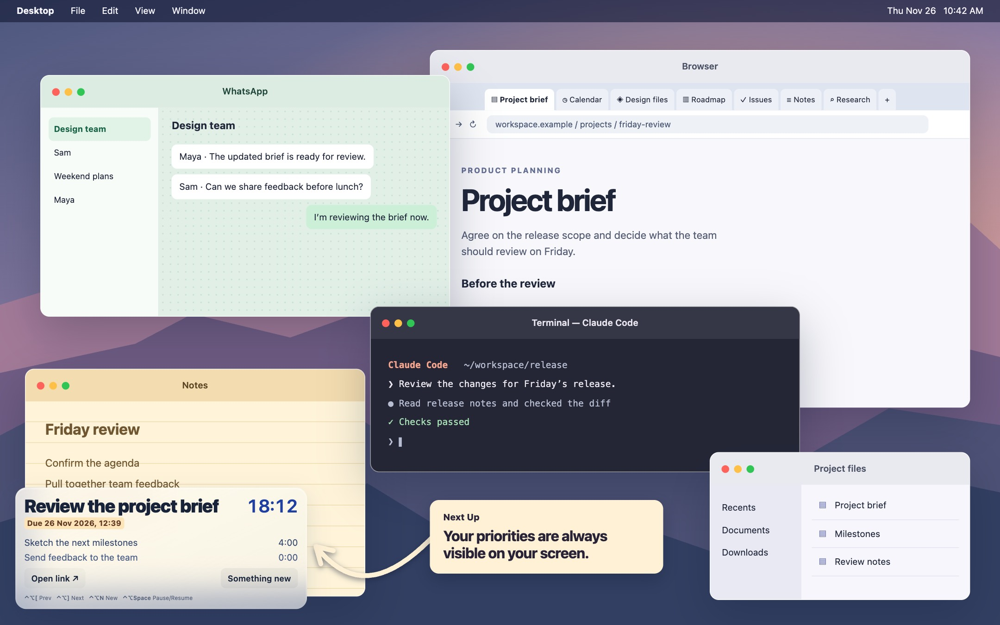

# Next Up



*The translucent Next Up panel keeps the current task, timer, and next two priorities visible over other windows.*


*Expanded view with the checklist, deadlines, and per-task timers.*

## Top features

1. **Keep your priorities in sight.** The floating window keeps your current task and next priorities visible above other apps.
2. **Get a visual reminder every five minutes.** The window flashes by default so you can check whether you’re still working on the task you intended.
3. **See where your time goes.** Each task tracks its own time and keeps the total when you switch.
4. **Switch tasks with a keyboard shortcut.** Press `Ctrl+Alt+[` or `Ctrl+Alt+]` to move between priorities. On Mac, use Option in place of Alt.

Next Up is a desktop focus companion for people who jump between tasks and lose track of what they meant to do next. For people with ADHD and anyone who finds it hard to hold several priorities in mind, the panel provides a visible place to pick up again after an interruption.

- Choose **Something new** to add a task and start tracking it.
- Find the panel at the bottom left. Always on Top is enabled by default. Use the pin icon to toggle it. The panel collapses when it loses focus.
- Switch tasks with a keyboard shortcut and keep the time already spent on each one.
- A running task resumes from its last saved total after a restart. The desktop timer excludes time when the computer sleeps and filters brief automatic wake-ups.
- Type or dictate a new task and optionally give it a deadline. Deadlines are highlighted during the final three hours.
- Right-click a task in the expanded list to edit its title, deadline, or link. **Open link** opens the current task’s link from either view.

Next Up is built with Rust and Tauri 2 and shares the same Mac-style interface across macOS, Windows, and Linux.

## Run and package

Install the [Tauri platform prerequisites](https://v2.tauri.app/start/prerequisites/) first. From this directory:

```sh
cargo run --manifest-path src-tauri/Cargo.toml
```

To build an installer on the target operating system:

```sh
cargo install tauri-cli --version "^2" --locked
cargo tauri build
```

The same three frontend files can also be served with `python3 -m http.server 8765` for browser preview. Desktop and browser have separate local task stores.

## GitHub releases

Run **Desktop releases** from the repository’s **Actions** tab to build and download installer artifacts. Push a version tag such as `v0.1.0` that matches `src-tauri/tauri.conf.json` to publish the installers to **Releases** after every build succeeds.

- Windows x64 gets an NSIS installer.
- macOS gets separate disk images for Apple silicon and Intel.
- Linux x64 gets a Debian package and an AppImage.

The workflow runs without distribution signing or macOS notarization credentials.

## Platform behavior

- The rounded glass tint is drawn inside a transparent, frameless Tauri window on all three platforms. On Linux, the compositor controls transparency, placement, and always-on-top behavior.
- Tauri's transparent macOS window support requires private APIs, which rules out Mac App Store distribution for this configuration.
- Ctrl+Alt/Option+[ and ] switch tasks, Ctrl+Alt/Option+N opens the composer, and Ctrl+Alt/Option+Space pauses or resumes the timer. Customize these shortcuts in **Settings**. Global registration relies on the Tauri shortcut plugin and uses X11 on Linux. Focused shortcuts are available as a fallback.
- The microphone uses the webview's speech recognition API when exposed. Typing works without speech recognition. Parakeet V3 is not bundled.

## Focus reminders on window switches

While a task is running, Next Up briefly highlights it when you switch windows. The reminder keeps keyboard focus in your current app. Keep Always on Top enabled if you want to see the pulse over other windows. Window detection works on macOS, Windows, and X11 desktops with `xprop` installed. Native Wayland windows are outside the X11 monitor's view.

The entire floating window flashes and shakes every five minutes by default. Open **Settings** from the expanded widget or the tray menu to change the interval, toggle the flash or shake, toggle window-switch highlights, or change Always on Top. With Reduce Motion enabled, the timed reminder uses a steady tint.
