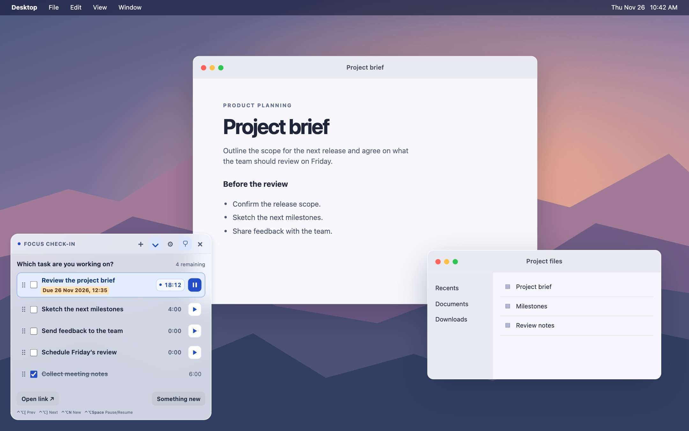

# Next Up




Next Up is a desktop focus companion for people who jump between tasks and lose track of what they meant to do next. The floating panel keeps your current priority and timer in sight, and a five-minute check-in gives you a chance to return to it or deliberately switch. For people with ADHD and anyone who finds it hard to hold several priorities in mind, the panel provides a visible place to pick up again after an interruption.

- On first launch, enter your next three tasks and optionally set a deadline for each. Next Up starts tracking your first priority when you save.
- Find the panel at the bottom left. Always on Top is enabled by default. Use the pin icon to toggle it. The panel collapses when it loses focus.
- Switch tasks with a keyboard shortcut and keep the time already spent on each one.
- A running task resumes from its last saved total after a restart. The desktop timer excludes time when the computer sleeps and filters brief automatic wake-ups.
- Type or dictate a new task and optionally give it a deadline. Deadlines are highlighted during the final three hours.
- Right-click a task in the expanded list and choose **Set deadline** to edit its title or deadline.

Next Up is built with Rust and Tauri 2 and shares the same Mac-style interface across macOS, Windows, and Linux.

## Run and package

Install the [Tauri platform prerequisites](https://v2.tauri.app/start/prerequisites/) first. From this directory:

```sh
cargo run --manifest-path src-tauri/Cargo.toml
```

To build an installer on the target operating system:

```sh
cargo install tauri-cli --version "^2" --locked
cargo tauri build
```

The same three frontend files can also be served with `python3 -m http.server 8765` for browser preview. Desktop and browser have separate local task stores.

## Platform behavior

- The rounded glass tint is drawn inside a transparent, frameless Tauri window on all three platforms. On Linux, the compositor controls transparency, placement, and always-on-top behavior.
- Tauri's transparent macOS window support requires private APIs, which rules out Mac App Store distribution for this configuration.
- Ctrl+Alt/Option+[ and ] switch tasks. Ctrl+Alt/Option+N opens the composer. Global registration relies on the Tauri shortcut plugin and uses X11 on Linux. Focused shortcuts are available as a fallback.
- The microphone uses the webview's speech recognition API when exposed. Typing works without speech recognition. Parakeet V3 is not bundled.

## Focus reminders on window switches

While a task is running, Next Up briefly highlights it when you switch windows. The reminder keeps keyboard focus in your current app. Keep Always on Top enabled if you want to see the pulse over other windows. Window detection works on macOS, Windows, and X11 desktops with `xprop` installed. Native Wayland windows are outside the X11 monitor's view.

Every five minutes, the floating window shakes and the first unfinished task flashes, even if its timer is paused. With Reduce Motion enabled, the task gets a stationary highlight.
